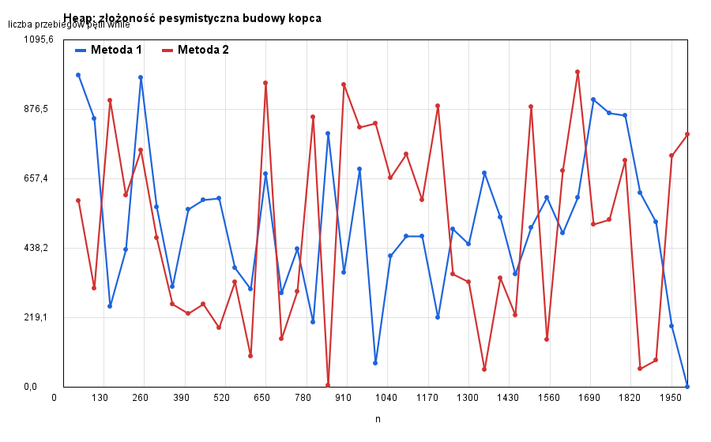

# Laboratorium: Kopiec prosty (Heap)

W pliku `src/Heap.java` implementujemy kopiec maksymalny. Możesz dodawać własne metody prywatne.

## Zadania

### 1a. Budowanie kopca

W pliku `src/Heap.java` zaimplementuj budowanie kopca z tablicy dwiema znanymi metodami:

- `static Heap createMethod1(int[] data)` – metoda 1,
- `static Heap createMethod2(int[] data)` – metoda 2.

Do działania testu potrzebne są także metody `delMax`, `size` i `isEmpty`:
- `int delMax()` – usuwa i zwraca największy element (`IllegalStateException`, gdy kopiec jest pusty),
- `int size()`
- `boolean isEmpty()`.

Uruchom `Main` i sprawdź poprawność budowania (metoda `testCreate`).

#### Opis algorytmów

Opisz oba algorytmy budowania kopca (metoda 1 i metoda 2).

**Metoda 1:**

**Metoda 2:**

### 2b. Badanie złożoności `create`

Dodaj licznik zliczający liczbę przebiegów pętli `while` podczas całego procesu budowania
(dla ustalonego `n`).

Zaproponuj zestaw danych, który jest pesymistyczny dla obu metod. Opisz ten zestaw wraz z uzasadnieniem.

**Zaproponowany zestaw danych i uzasadnienie:**

....
....

Uzupełnij metodę `testCreateComplexity` w `Main.java`.
Po uruchomieniu `Main` powstaje plik `heap_create_complexity.png`, który jest dołączony poniżej.

Uwaga!!

Pliku `Chart.java` nie modyfikuj. Do narysowania wykresu obu metod użyj funkcji
`Chart.draw(ns, ys, label1, ys2, label2, title, file)`, która przyjmuje:
- `ns` – listę rozmiarów kopca (oś X),
- `ys` – listę liczb przebiegów pętli dla metody 1 (oś Y) oraz `label1` – jej etykietę,
- `ys2` – listę liczb przebiegów pętli dla metody 2 (może być `null`) oraz `label2` – jej etykietę,
- `title` – tytuł wykresu,
- `file` – nazwę pliku wyjściowego,

#### Złożoność

Uzupełnij tabelę (złożoność budowania kopca o `n` elementach).

| Metoda    | Przypadek optymistyczny | Przypadek pesymistyczny | Uzasadnienie |
|-----------|-------------------------|-------------------------|--------------|
| Metoda 1  |                         |                         |              |
| Metoda 2  |                         |                         |              |

Skomentuj wykres:

Jaki kształt mają wykresy obu metod, jak mają się do teoretycznej złożoności? 

....

